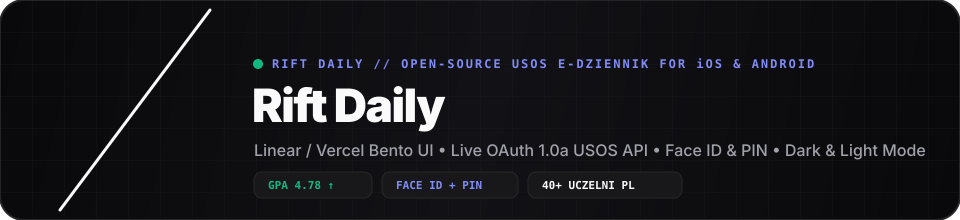
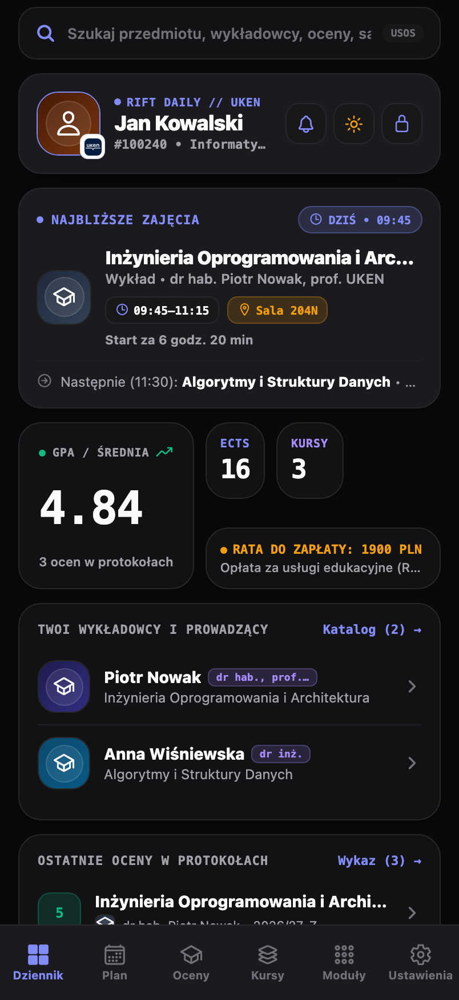
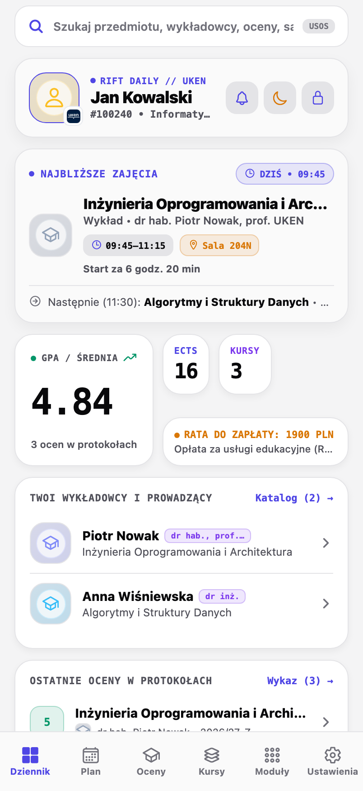
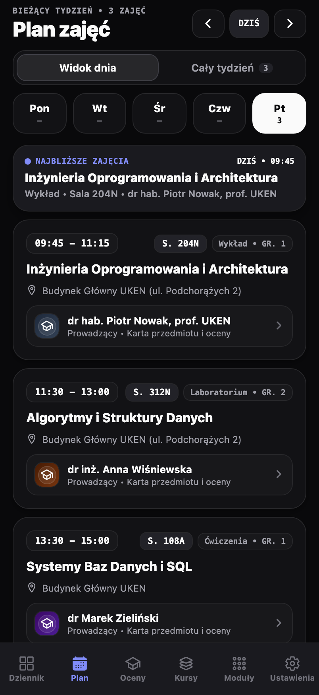
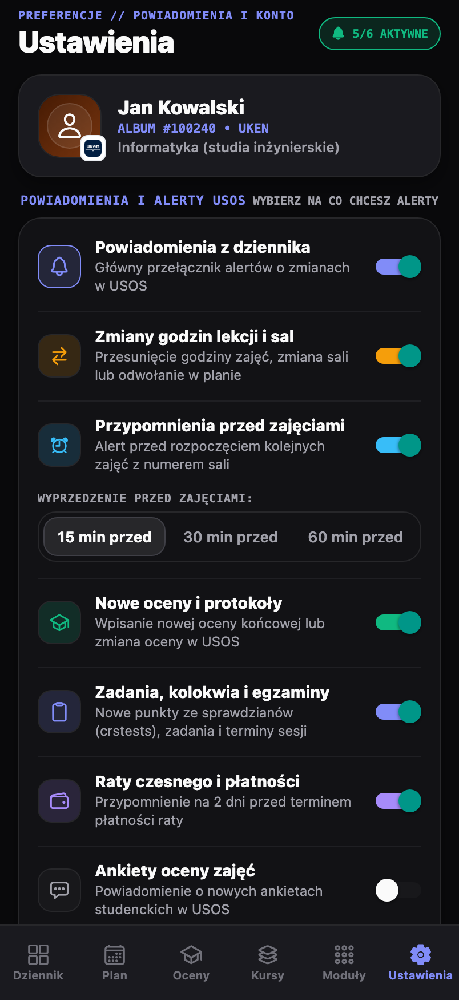
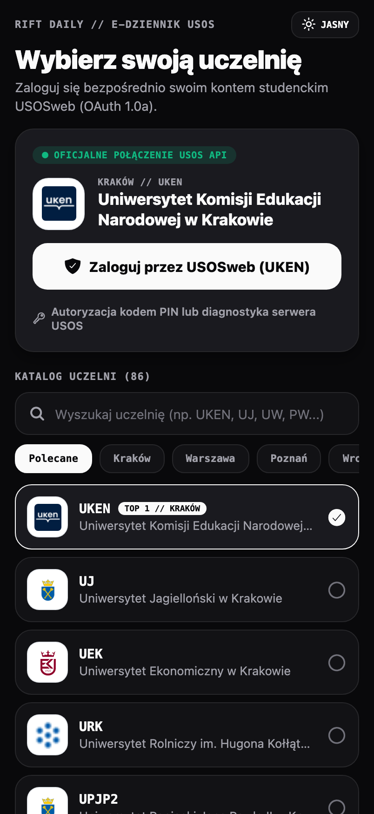

<div align="center">



<br />


# Rift Daily

### Nowoczesny, superszybki mobilny **e-Dziennik Studencki USOS** na iOS i Androida

[](./LICENSE)
[](https://docs.expo.dev/)
[](https://reactnative.dev/)
[](#instrukcja-instalacji-i-uruchomienia-ios--android)
[](#architektura-projektu)

<p align="center">
  <b>Rift Daily</b> to zaprojektowany od podstaw kliencki e-dziennik akademicki w estetyce <b>Linear / Vercel Bento UI</b>, łączący się bezpośrednio z oficjalnym serwerem <b>USOS API (OAuth 1.0a)</b> polskich uczelni wyższych (m.in. <b>UKEN Kraków, UJ, AGH, PK, UEK, UW, PW, UAM, PWr, UWr, UMK, UŚ, PG, PŁ, KUL, SGH</b> i ponad 80 innych).
</p>

[**⭐ Jeśli aplikacja Ci się podoba — zostaw gwiazdkę (Star) na GitHubie!**](https://github.com/matiqueue/rift-daily/stargazers)

</div>

---

## 📱 Prawdziwe zrzuty ekranu z aplikacji (Real App Screenshots)

<div align="center">
<table>
  <tr>
    <td align="center" width="33%">
      <b>🌙 Dziennik (Motyw Ciemny)</b><br />
      <sub>Najbliższe zajęcia + Bento Grid</sub><br /><br />
      
    </td>
    <td align="center" width="33%">
      <b>☀️ Dziennik (Motyw Jasny)</b><br />
      <sub>Clean Daylight Paper UI</sub><br /><br />
      
    </td>
    <td align="center" width="33%">
      <b>🗓️ Plan Zajęć USOS</b><br />
      <sub>Najbliższe zajęcia i sale</sub><br /><br />
      
    </td>
  </tr>
</table>

<br />

<table>
  <tr>
    <td align="center" width="50%">
      <b>🔔 Ustawienia i Powiadomienia USOS</b><br />
      <sub>Wybór alertów o zmianach godzin, ocenach, zadaniach i ratach</sub><br /><br />
      
    </td>
    <td align="center" width="50%">
      <b>🏛️ Wybór Uczelni (86 uczelni USOS)</b><br />
      <sub>UKEN Kraków jako Top 1 + logowanie OAuth 1.0a</sub><br /><br />
      
    </td>
  </tr>
</table>
</div>

---

## 🚀 Najważniejsze funkcje

| Moduł | Opis możliwości | Endpointy USOS API / Natywne |
| :--- | :--- | :--- |
| **⏱️ Karta „Najbliższe Zajęcia” na żywo** | Natychmiastowy podgląd aktualnie trwających lub najbliższych zajęć na samej górze ekranu głównego i planu zajęć (odliczanie czasu, numer sali, budynek, prowadzący oraz kolejne zajęcia po nich). | `services/tt/user` + `timetableUtils.ts` |
| **🔔 Powiadomienia o zmianach planu, ocenach i zadaniach** | Alerty o zmianie godzin lekcji lub sal, przypomnienia przed zajęciami (`15/30/60 min`), nowe oceny w protokołach, punkty z zadań/kolokwiów (`crstests`) oraz terminy rat (obsługa iOS & kanałów powiadomień Android `POST_NOTIFICATIONS`). | `expo-notifications` + silnik detekcji zmian |
| **⚙️ Dedykowana zakładka Ustawienia** | Pełna kontrola preferencji powiadomień (osobne przełączniki na co mają przychodzić alerty), tester powiadomień na żywo, historia zmian, motyw i blokada PIN/Biometria. | `src/app/(tabs)/settings.tsx` |
| **🔍 Globalna wyszukiwarka na górze ekranu** | Błyskawiczne przeszukiwanie przedmiotów, prowadzących, sal, ocen i modułów prosto z paska nad kartą studenta. | Lokalny indeks + `services/users/search2` |
| **🔐 Domyślna blokada Face ID / Biometria + PIN** | Konfiguracja 4-cyfrowego kodu PIN oraz biometrii (Face ID / Touch ID na iOS, czytnik linii papilarnych / rozpoznawanie twarzy na Androidzie). | `expo-local-authentication` + `expo-secure-store` |
| **📊 Asymetryczny Bento Dashboard** | Szybki podgląd średniej ważonej (`GPA`), punktów `ECTS`, liczby kursów, najbliższej raty do opłacenia oraz aktualnego planu. | `services/grades/*` + `services/courses/*` |
| **🎓 Oceny, Rozkład i Symulator ECTS** | Wielowarstwowe pobieranie ocen z protokołów (`terms2`, `latest`, `course_editions`), wykres rozkładu ocen i symulator „What-If”. | `services/grades/terms2` + `services/grades/latest` |
| **👨‍🏫 Katalog Wykładowców w HD** | Pełne tytuły naukowe (`dr`, `dr hab.`, `prof.`), portrety w wysokiej rozdzielczości (`original`/`400x500`), pokoje, e-maile i godziny konsultacji. | `services/users/users` + `services/users/search2` |
| **💳 Naprawione Raty, IBAN i Przelewy** | Dokładne wyliczanie kwot poszczególnych rat z planów ratalnych (`chosen_installment_plan`), kopiowanie konta IBAN jednym kliknięciem oraz bezpośrednie przejście do płatności USOSweb. | `services/payments/user_payments` + `user_accounts` |
| **🪪 Elektroniczna Legitymacja (ELS)** | Cyfrowa karta studenta ze zdjęciem w wysokiej rozdzielczości, numerem albumu, kodem kreskowym karty bibliotecznej i kodem QR. | `services/cards/user_cards` + `services/users/user` |

---

## 🛠️ Instrukcja instalacji i uruchomienia (iOS & Android)

### Krok 1: Klonowanie i instalacja pakietów

```bash
git clone https://github.com/matiqueue/rift-daily.git
cd rift-daily
npm install
```

---

### 🤖 Uruchomienie i konfiguracja na **Androidzie** (Poradnik krok po kroku)

Aplikacja **Rift Daily** jest w pełni przystosowana pod system **Android** (obsługuje natywne kanały powiadomień `AndroidImportance.MAX`, uprawnienia `POST_NOTIFICATIONS` dla Androida 13+, czytnik linii papilarnych / biometrię `USE_BIOMETRIC`, adaptacyjną ikonę oraz głębokie linkowanie `betterusos://oauth-callback` dla logowania USOS).

#### Wymagania dla Androida:
1. Zainstalowany **Android Studio** (wraz z *Android SDK Platform 35*, *Android SDK Build-Tools* oraz *Platform-Tools / `adb`*).
2. **JDK 17** (np. `brew install --cask zulu@17` na macOS lub wbudowany JBR z Android Studio).
3. Skonfigurowane zmienne środowiskowe `ANDROID_HOME` (w `~/.zshrc` lub `~/.bashrc`):
   ```bash
   export ANDROID_HOME=$HOME/Library/Android/sdk   # macOS (na Linuxie: $HOME/Android/Sdk)
   export PATH=$PATH:$ANDROID_HOME/emulator:$ANDROID_HOME/platform-tools
   ```

#### Opcja A: Uruchomienie bezpośrednio na telefonie z Androidem przez USB / Wi-Fi
1. Na telefonie z Androidem wejdź w **Ustawienia → Informacje o telefonie** i kliknij 7 razy w **Numer kompilacji**, aby odblokować **Opcje programistyczne**.
2. Wejdź w **Ustawienia → System → Opcje programistyczne** i włącz **Debugowanie USB** (lub **Debugowanie bezprzewodowe**).
3. Podłącz telefon kablem USB do komputera i zaakceptuj komunikat *„Zezwól na debugowanie USB”* (sprawdź połączenie komendą `adb devices`).
4. Wygeneruj projekt natywny Androida (jeśli folder `android/` jeszcze nie istnieje) i uruchom kompilację:
   ```bash
   npx expo prebuild --platform android
   npx expo run:android --device
   ```

#### Opcja B: Wygenerowanie samodzielnego pliku instalacyjnego `.apk` (Release APK)
Jeśli chcesz wygenerować gotowy plik `.apk`, który możesz przesłać na dowolny telefon z Androidem i zainstalować bez podłączania do komputera:

```bash
# 1. Wygeneruj natywny katalog android/ (jednorazowo)
npx expo prebuild --platform android

# 2. Zbuduj zoptymalizowany pakiet Release APK
cd android
./gradlew assembleRelease

# Gotowy plik APK znajdziesz w:
# android/app/build/outputs/apk/release/app-release.apk
```
Następnie możesz zainstalować go na podłączonym telefonie komendą:
```bash
adb install -r android/app/build/outputs/apk/release/app-release.apk
```

#### Opcja C: Budowanie `.apk` w chmurze przez EAS Build (bez Android Studio)
Jeśli nie chcesz instalować lokalnie Android Studio ani SDK:
```bash
npx eas-cli@latest build --platform android --profile preview
```

---

### 🍎 Uruchomienie i kompilacja na **iPhonie (iOS)**

#### Opcja A: Szybkie uruchomienie deweloperskie
```bash
npx expo run:ios --device
```

#### Opcja B: Samodzielna wersja **Release** na fizycznego iPhone'a (działa bez komputera i bez Metro)
```bash
export DEVELOPER_DIR=/Applications/Xcode.app/Contents/Developer
xcodebuild -workspace ios/BetterUSOS.xcworkspace \
  -scheme BetterUSOS \
  -configuration Release \
  -destination 'generic/platform=iOS' \
  -derivedDataPath ios/build \
  -allowProvisioningUpdates build
```

---

## 🏗️ Architektura projektu

```text
rift-daily/
├── assets/images/               # Ikona aplikacji Rift Daily (1024x1024) i grafiki splash
├── docs/assets/                 # Animowany baner SVG oraz prawdziwe zrzuty ekranu z aplikacji
├── src/
│   ├── api/
│   │   ├── installations.ts     # Katalog ponad 80 polskich uczelni (UKEN jako Top 1)
│   │   ├── oauth1.ts            # Implementacja podpisów kryptograficznych HMAC-SHA1 OAuth 1.0a
│   │   ├── types.ts             # Definicje typów TypeScript dla encji USOS API
│   │   └── usosClient.ts        # Klient USOS API (kursy, oceny, wykładowcy, raty, zdjęcia HD)
│   ├── app/
│   │   ├── _layout.tsx          # Ekran ładowania + bramka bezpieczeństwa PIN / Face ID
│   │   ├── login.tsx            # Wybór uczelni i logowanie OAuth 1.0a / PIN
│   │   ├── (tabs)/              # Ekrany: Dziennik, Plan, Oceny, Kursy, Moduły, Ustawienia
│   │   └── modal/               # Modale szczegółów przedmiotu, modułów USOS i diagnostyki API
│   ├── components/
│   │   ├── AppLoadingScreen.tsx # Animowany ekran startowy i synchronizacji
│   │   ├── Avatar.tsx           # Portrety HD z estetycznymi sylwetkami zastępczymi
│   │   ├── GlassCard.tsx        # Karty Bento ze sprężystymi animacjami Reanimated
│   │   ├── GradeBadge.tsx       # Monospace'owe plakietki ocen (5.0, 4.5, ZAL)
│   │   └── SecurityGateOverlay.tsx # Ekran blokady i konfiguracji PIN + Face ID / Biometria
│   ├── services/
│   │   └── notifications.ts     # Silnik powiadomień iOS/Android o zmianach lekcji, ocenach i ratach
│   ├── store/
│   │   └── useUsosStore.ts      # Magazyn stanu Zustand + bezpieczny zapis w Keychain / Keystore
│   ├── theme/
│   │   └── theme.ts             # System 2 motywów: Ciemny (#09090B) i Jasny (#F4F4F5)
│   └── utils/
│       └── timetableUtils.ts    # Wyznaczanie trwających i najbliższych zajęć z odliczaniem czasu
├── LICENSE                      # Licencja Non-Commercial (100% Darmowe / Zakaz komercjalizacji)
└── README.md                    # Dokumentacja projektu (iOS & Android)
```

---

## 🤝 Współtworzenie (Contributing)

Projekt ma otwarty kod źródłowy i jest tworzony przez studentów dla studentów! Jeśli chcesz dodać obsługę nowego modułu USOS lub ulepszyć aplikację:

1. Zrób **Fork** repozytorium
2. Utwórz nową gałąź (`git checkout -b feat/nowa-funkcja`)
3. Zatwierdź zmiany (`git commit -m 'feat: dodano nową funkcję'`)
4. Wypchnij gałąź (`git push origin feat/nowa-funkcja`) i otwórz **Pull Request**

---

## 📄 Licencja (100% Darmowe — Zakaz Komercjalizacji)

Ten projekt jest udostępniany na licencji **Rift Daily Non-Commercial Open Source License** — pełną treść znajdziesz w pliku [LICENSE](./LICENSE).

- **100% Darmowe dla studentów**: Możesz dowolnie pobierać, uruchamiać, modyfikować i rozwijać aplikację w celach osobistych, akademickich i edukacyjnych.
- **Bezwzględny zakaz spieniężania (No Monetization / Non-Commercial)**: Zabrania się sprzedaży aplikacji lub jej części, wprowadzania płatnych subskrypcji (paywalli), mikropłatności, reklam zarobkowych oraz wykorzystywania kodu w produktach komercyjnych. Aplikacja oraz wszelkie jej forki muszą pozostać **całkowicie darmowe**.

<div align="center">
  <sub>Stworzone z pasją dla studentów polskich uczelni • <b>Rift Daily // e-Dziennik USOS (iOS & Android)</b></sub>
</div>
