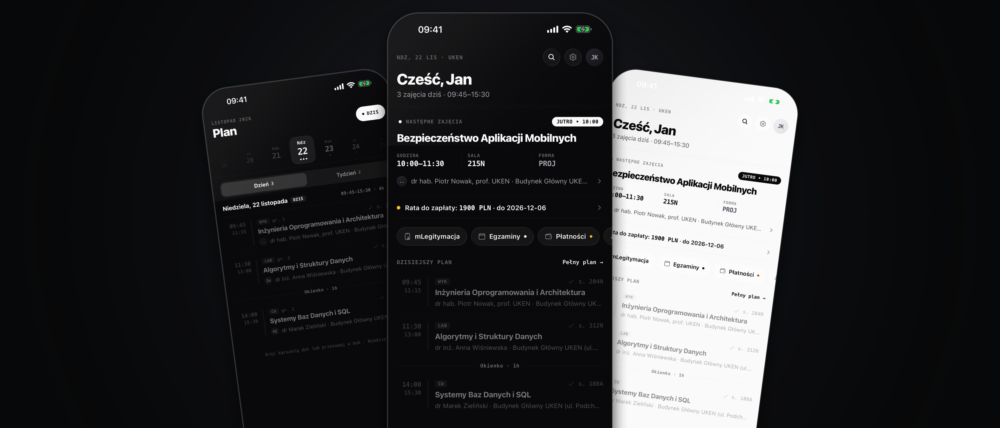
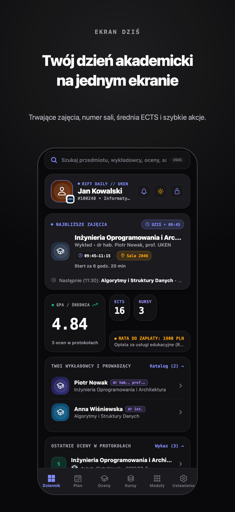
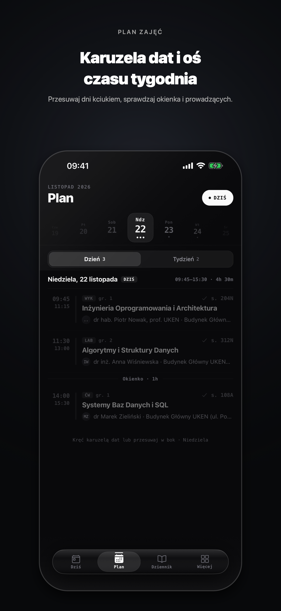
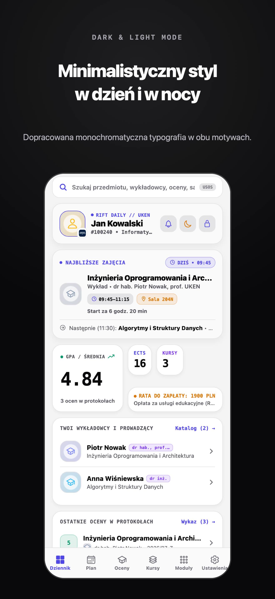
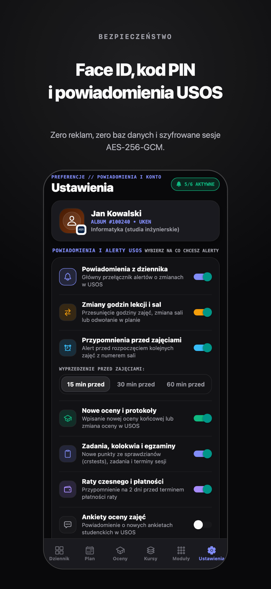
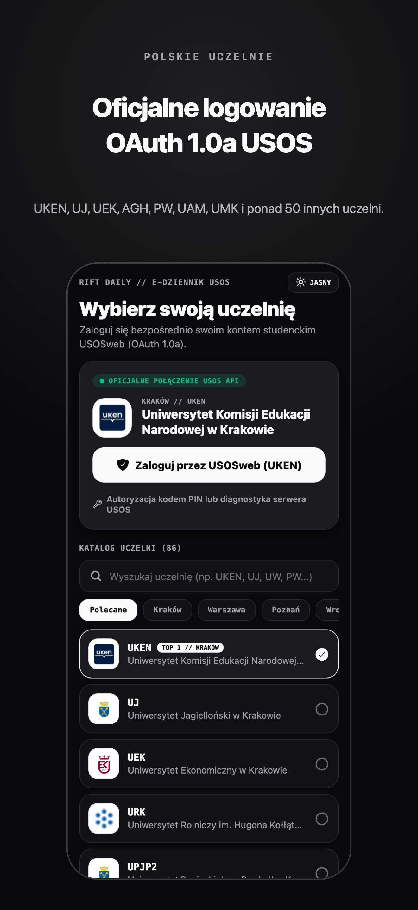

<div align="center">



<br />

### Nowoczesny, minimalistyczny mobilny **e-Dziennik Studencki USOS** na iOS i Androida

[](https://apps.apple.com/app/id6837895381)
[](https://github.com/matiqueue/rift-daily/releases/latest/download/RiftDaily.apk)
[](https://rift-daily.vercel.app)
[](https://github.com/matiqueue/rift-daily/actions/workflows/ci.yml)
[](https://docs.expo.dev/)
[](./LICENSE)

<p align="center">
  <b>Rift Daily</b> to szybki, niezależny klient akademicki w monochromatycznej estetyce <b>Titanium / Obsidian / Paper</b>, łączący się z oficjalnym serwerem <b>USOS API (OAuth 1.0a)</b> ponad 50 polskich uczelni (m.in. <b>UKEN, UJ, AGH, UEK, UW, PW, UAM, PWr, UWr, UMK, PG, UŚ, SGH, KUL</b>) przez bezstanowe, szyfrowane proxy <b>Zero-Secret BFF</b>.
</p>

<p align="center">
  🌐 <b><a href="https://rift-daily.vercel.app">rift-daily.vercel.app</a></b> &nbsp;•&nbsp;
  🍎 <b><a href="https://apps.apple.com/app/id6837895381">App Store (iOS)</a></b> &nbsp;•&nbsp;
  🤖 <b><a href="https://github.com/matiqueue/rift-daily/releases/latest/download/RiftDaily.apk">Pobierz APK (Android)</a></b>
</p>

</div>

---

## 📱 Zrzuty ekranu (v3.1.2)

<div align="center">
<table>
  <tr>
    <td align="center" width="33%">
      <b>🌙 Ekran „Dziś”</b><br />
      <sub>Bieżące zajęcia, średnia ECTS i szybki start z pamięci</sub><br /><br />
      
    </td>
    <td align="center" width="33%">
      <b>🗓️ Plan zajęć</b><br />
      <sub>Karuzela dat, okienka i prowadzący</sub><br /><br />
      
    </td>
    <td align="center" width="33%">
      <b>☀️ Motyw Jasny (Paper)</b><br />
      <sub>Pełna parytetowość Obsidian & Paper</sub><br /><br />
      
    </td>
  </tr>
</table>

<br />

<table>
  <tr>
    <td align="center" width="50%">
      <b>🔐 Bezpieczeństwo i Prywatność</b><br />
      <sub>Zero-Secret BFF, Keychain / Keystore, Face ID & PIN</sub><br /><br />
      
    </td>
    <td align="center" width="50%">
      <b>🏛️ Logowanie USOS OAuth 1.0a</b><br />
      <sub>50+ polskich uczelni bezpośrednio na portalu CAS</sub><br /><br />
      
    </td>
  </tr>
</table>
</div>

---

## ✨ Co nowego i najważniejsze funkcje

- **⚡ Natychmiastowy start z pamięci podręcznej + pigułka synchronizacji**: aplikacja ładuje ostatnią migawkę planu, ocen i kursów w <200 ms, a dyskretna pigułka u góry ekranu informuje o aktualizacji w tle (*„Pobieram najnowsze dane...”* → *„Zaktualizowano dane”*).
- **🧭 4 przejrzyste zakładki (`Dziś`, `Plan`, `Dziennik`, `Więcej`)**: kompaktowy, czarny szklany pasek nawigacji (`FloatingGlassTabBar`), przyklejony nagłówek *„Cześć, …”* i karuzela dat z przyciskiem `DZIŚ`.
- **🎓 Dziennik ocen i symulator ECTS**: średnia ważona w czasie rzeczywistym, filtry ocen, podział na semestry i symulator „What-If”.
- **🪪 Moduły studenckie**: mLegitymacja (ELS), egzaminy, raty i kopiowanie numeru IBAN jednym kliknięciem, ankiety oraz wyszukiwarka kadry.
- **🔒 Architektura Zero-Secret (Vercel BFF)**:
  - Zero kluczy `USOS_SECRET_*` w kodzie mobilnym — wszystkie sekrety żyją wyłącznie w Vercel Environment Variables (`--sensitive`).
  - Bezstanowe szyfrowane sesje **AES-256-GCM**, przechowywane wyłącznie w **iOS Keychain / Android Keystore** (`expo-secure-store`, `AFTER_FIRST_UNLOCK_THIS_DEVICE_ONLY`).
  - Ochrona anty-SSRF, ścisła biała lista 19 metod read-only USOS API, 60-sekundowy cache deduplikacji i rate limiting.
  - Zero reklam, zero zewnętrznych baz danych studentów i natychmiastowe usunięcie danych lokalnych w Ustawieniach.

---

## 🛠️ Uruchomienie lokalne (Development)

```bash
git clone https://github.com/matiqueue/rift-daily.git
cd rift-daily
npm install
cp .env.example .env.local
```

### Weryfikacja i testy
```bash
./node_modules/.bin/tsc --noEmit    # TypeScript check (mobile)
npm test                            # Vitest unit tests (security, storage, cache)
npx expo lint                       # ESLint + React Compiler check
npx --yes expo-doctor               # Dependency & config health
cd website && npm run build         # Website + BFF API build
```

### Budowanie na urządzeniu
- **iOS**: `npx expo run:ios --device` (produkcja App Store: `./scripts/release-ios-appstore.sh`)
- **Android**: `npx expo prebuild --platform android && npx expo run:android --device`

---

## ⚡ Automatyzacja CI/CD (GitHub Actions)

- **[`ci.yml`](./.github/workflows/ci.yml)**: uruchamia się na każdym pushu i PR do `main` / `dev` — weryfikuje `tsc --noEmit`, `expo lint`, testy jednostkowe **Vitest**, konfigurację Expo oraz build strony `website/`.
- **[`android-release.yml`](./.github/workflows/android-release.yml)**: po wypchnięciu taga `v*.*.*` buduje podpisany `.aab` + `.apk` (Expo CNG + Upload Keystore z GitHub Secrets) i publikuje **GitHub Release** z automatycznym opisem z [`CHANGELOG.md`](./CHANGELOG.md).

---

## 🏗️ Struktura repozytorium

```text
rift-daily/
├── .github/workflows/           # CI (TypeScript, ESLint, Vitest, Website) + Android Release (.aab/.apk)
├── assets/                      # Ikony, screenshoty App Store (iPhone + iPad), banery, Play Store
├── docs/                        # PROJECT_MEMORY.md, ARCHITECTURE.md, RELEASE_AND_STORES.md
├── plugins/                     # Expo CNG config plugin (withAndroidReleaseSigning.js)
├── scripts/                     # SemVer bump, App Store Connect API automation, iOS release script
├── src/
│   ├── api/                     # Katalog 50+ uczelni USOS, klient BFF, typy TypeScript
│   ├── app/                     # Expo Router: (tabs)/ [Dziś, Plan, Dziennik, Więcej], login, modale
│   ├── components/              # FloatingGlassTabBar, DateWheelCarousel, SyncStatusBanner, SecurityGate
│   ├── services/                # Powiadomienia lokalne i odświeżanie w tle (expo-background-task)
│   ├── store/                   # Zustand store + natychmiastowy cache (dataCache.ts)
│   ├── theme/                   # Paleta Titanium / Obsidian / Paper (Dark + Light)
│   └── utils/                   # secureStorage.ts (Keychain/Keystore), dataCache.ts, timetableUtils.ts
└── website/                     # Wizytówka Vite + React 19 + Tailwind CSS + Vercel BFF (/api/usos/*)
```

---

## 📄 Dokumentacja i licencja

- [Architektura i mapa kodu](./docs/ARCHITECTURE.md)
- [Pamięć projektu i bezpieczeństwo](./docs/PROJECT_MEMORY.md)
- [Wydania i publikacja w sklepach](./docs/RELEASE_AND_STORES.md)
- [Historia zmian (CHANGELOG)](./CHANGELOG.md)
- [Polityka prywatności](https://rift-daily.vercel.app/privacy) · [Regulamin](https://rift-daily.vercel.app/terms) · [Pomoc](https://rift-daily.vercel.app/support)
